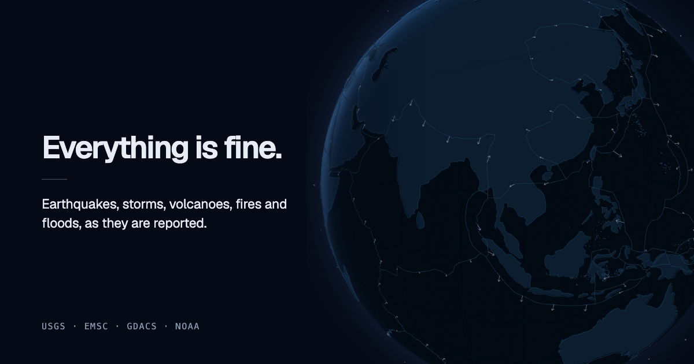

# Everything Is Fine

An interactive globe for live earthquakes, storms, volcanoes, wildfires, floods, and aurora.
Explore a region, compare two agencies' earthquake readings, revisit a past day, or share a view.

[Open the app](https://everythingisfine.aidenjang.com) ·
[Architecture](SYSTEM.md) · [Contributing](CONTRIBUTING.md) · [Deployment](DEPLOY.md)



## Run locally

Use Node.js 22 (22.22.2 or newer within that major) and pnpm 9.15.0. The package-manager version is pinned in
`package.json`; `.nvmrc` selects the Node version used by CI. With nvm installed, run `nvm use`
before installing dependencies. No API keys, accounts, environment file, or backend are needed to run the app.

```bash
corepack enable
pnpm install --frozen-lockfile
pnpm run dev
```

Open <http://localhost:31600>. Fonts and map geometry are bundled; public data feeds are
requested directly from the browser.

## Observe and explore

A fresh visit opens the observatory: a full globe, a short introduction, and three scenes.
**Explore** opens the scientific controls. The wordmark returns to the observatory, resets the view, and replays its horizon-to-orbit arrival.
Existing saved layouts and links to an event, archive, section, or held moment open the explorer directly.

- **Live Earth** frames current activity and traces the day–night boundary. Choosing it from an
  archive returns to live.
- **Below the Surface** flies to the deepest visible earthquake, settles at an angle, and opens
  a cutaway with true-scale reference guides and historical seismicity. It is available when the
  view contains a reported depth of at least 70 km.
- **After Dark** opens the displayed moment's night sky above Earth's curved horizon, then traces
  constellation guides. Reduced motion keeps the same view without the flight.
- **Follow the aurora** in After Dark banks over a dark-side NOAA OVATION forecast oval and settles
  into a polar view. The readout shows the forecast time and modeled chance at the focus. The
  raised glow illustrates the footprint. Reduced motion opens the polar view directly.
- **Take a tour** visits a captured selection of readings and regions. Narration waits for arrival;
  Pause, Previous, Next, Stop, and Read this event remain available. Hidden tabs pause its reading time.
- **Revisit a day** loads an archived day and frames its largest available event.
- **Watch Tōhoku rupture** follows the 2011 earthquake from its epicenter to the modeled fault
  beneath the ocean and then to estimated shaking across Japan. Choose **Fault slip** or
  **Shaking** to inspect either view. Reduced motion opens the finished fault view.
- **Save view** uses the existing captioned image export, including the reference-cutaway label.

The opening pulls back from the horizon into orbit. Long camera flights bank gently, bright stars
leave short photographic trails during travel, and scene reveals briefly lift the atmosphere's light.
Constellation guides trace with a leading glint; cutaway reference rings draw in sequence. Headline
words arrive with a staggered reveal. These are finite presentation effects; reduced motion skips them.

Scenes are temporary: returning to Explore restores the saved layer and projection choices. Choosing
Observe or Explore remembers that presentation; opening the app alone saves no new preference.

## Explore

- Drag to orbit, scroll to zoom, or use the arrow keys and `+` / `-`. Press `0` to reset the camera.
- Select an earthquake to pin its details and see each agency's original magnitude and scale.
- Change magnitude, feeds, or the time window. Search by region or place.
- Choose **Map** to unfold the globe at its seam. Choose **Globe** to wrap it back up. On the flat map,
  draw a cross-section with Shift-drag. Release the line to fold it open into the depth chart.
- Browse any completed UTC day, including notable earthquakes and eclipses. Find the total eclipse
  of 8 April 2024 under **Revisit a day** in the Observatory or **Eclipses** in Explore. Choose
  **Watch eclipse** in Globe view, then pause or scrub to follow the shadow at a specific UTC time.
- Pin an earthquake and open **Follow the wave**. Pick a nearby city to see the estimated P and
  S arrivals, with a fixed overview under reduced motion. The city picker lists up to six places
  within 700 km.
- Choose **Replay sequence** in a pinned earthquake’s nearby activity to see the recorded events
  appear in order. The UTC timeline can be scrubbed, including in the fixed reduced-motion view.
- Open **Watch Tōhoku rupture** from the 11 March 2011 archive or the pinned mainshock.
- On a phone, switch between globe space and recent events using the bottom navigation.
- Use **Still** to share or download a captioned image. If native sharing fails, **Download image**
  keeps that captured frame available. Cancelling the share sheet leaves the page alone.
  The URL retains the view and selection.
- Press `f` for fullscreen, Space to play the window, and `,` / `.` to step through it.
  On the time slider, Home selects the start and End returns to live (or the archived day end).

## Validate

```bash
pnpm run verify          # repository checks and the complete browser suite
pnpm run test:heap       # unit and performance tests with the memory gate enabled
pnpm run test:e2e        # release journeys and separate development-only camera probes
pnpm run test:e2e:build  # release journeys only, against the production bundle
pnpm run test:live       # deliberate check against real agency endpoints
```

CI runs browser shards on separate runners so each has its own software-rendered globe.
Every shard must pass. Job logs record durations; failed runs retain results and traces as artifacts. Live feed checks
run separately on a daily schedule and do not block pull requests.
The ordinary journeys run against the release bundle; only camera/store instrumentation uses
the development server. [Quality checks](docs/quality.md) explains the two origins and local captures.

See [quality checks](docs/quality.md) for recovery and responsive coverage.
Use the [visitor walkthrough](docs/visitor-review.md) for real-phone and first-visit observations.

## Data and attribution

| Layer | Source |
| --- | --- |
| Live earthquakes | USGS HTTPS feeds and EMSC WebSocket / catalogue |
| Archived earthquakes | USGS and EMSC FDSN endpoints |
| Live storms, volcanoes, wildfires, floods | GDACS, retaining the credited reporting agency |
| Archived hazards | NASA EONET |
| Aurora forecast | NOAA SWPC OVATION |
| Coastlines and replay cities | Natural Earth, public domain |
| Plate boundaries | PB2002, Bird (2003), simplified for display |
| Tōhoku rupture and shaking | USGS finite-fault model and preferred ShakeMap Atlas MMI contours |
| Stars | Yale Bright Star Catalogue, BSC5 |
| Constellation figures | d3-celestial, copyright (c) 2015 Olaf Frohn, BSD 3-Clause |

The sun, moon, planets, and eclipse geometry are calculated locally. The 8 April 2024 replay uses
NASA’s two-minute path predictions from 16:40 to 19:54 UTC, with approximate shading.
[Bundled path samples and NASA source](src/geo/aprilEclipseData.ts).

The Tōhoku view compresses the modeled rupture times and exaggerates depth by four to make the
fault visible. The shaking contours show estimated intensity for the event. [USGS Tōhoku record](https://earthquake.usgs.gov/earthquakes/eventpage/usc0001xgp).

Colour represents magnitude. Other hazards use distinct shapes, with neutral interface controls.

Under **Feeds and layers**, **Regional cutaway** opens the pinned earthquake's region, or the
centre of the view. Orbit to inspect events at their reported depths. The neutral well has 300 km
reference guides down to 900 km; it does not represent geological layers. Switch the cutaway off
in the same menu, or turn depth off. The flat map temporarily hides the opening. Constellations
trace on enable, and camera coordinates appear briefly while you move the view. Reduced motion
keeps all actions available with these effects skipped.

## Limits

The reconciliation rule can combine nearby aftershocks with a mainshock. Both agencies'
readings remain visible; [reconciliation policy](SYSTEM.md#reconciliation) explains the tradeoff.
An unanswered feed is shown separately from a feed that reports no events.

Historical coverage is uneven, especially before 1970. Archived hazards use EONET rather than
the live GDACS catalogue, and aurora is only a forecast. Eclipse shadows are approximate
illustrations. This is an exploration tool, not an emergency alert or eclipse forecast service.

The default week window downloads a larger earthquake seed than the daily window. Optional
slab, plate-motion, and constellation data load when requested. WebGL is required for the globe;
if it cannot start, the event list and filters remain available.

## Repository

[SYSTEM.md](SYSTEM.md) describes the current boundaries and data flow.
[ARCHITECTURE.md](ARCHITECTURE.md) explains indexed engineering constraints.
[DESIGN.md](DESIGN.md) defines the visual system.

Pushing to `main` triggers the existing Cloudflare deployment after verification succeeds.
The app serves static assets with a small anonymous aggregate-analytics Worker and no database. Public feed requests stay in the browser. See [DEPLOY.md](DEPLOY.md).

Code is [MIT licensed](LICENSE). Report vulnerabilities through
[private reporting](https://github.com/aiden-jang/everythingisfine/security/advisories/new).

The SVG globe mark in `public/icon.svg` also has committed 32px browser and
180px Apple touch PNGs. Keep the Apple variant opaque and square; iOS applies its
own mask. The PNGs are raster derivatives of that SVG, without changing the globe.

Aggregate traffic and feature-event coverage, privacy boundaries and queries: [Analytics](docs/ANALYTICS.md).
