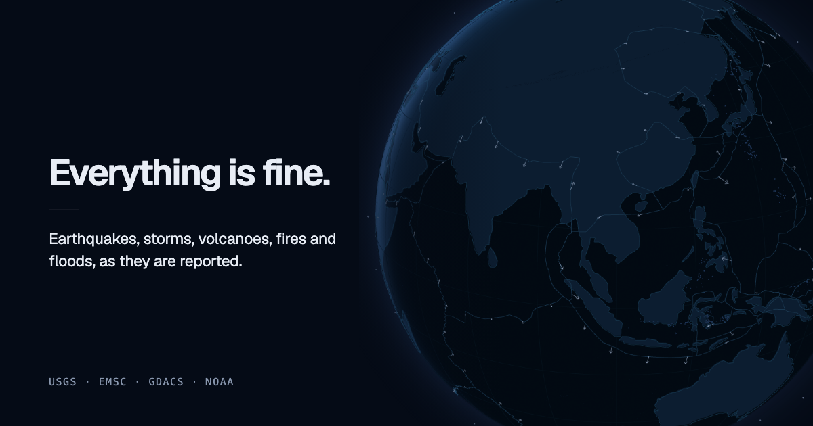

# Everything Is Fine

An interactive globe for live earthquakes, storms, volcanoes, wildfires, floods, and aurora.
Explore a region, compare two agencies' earthquake readings, revisit a past day, or share a view.

[Open the app](https://everythingisfine.aidenjang.com) ·
[Architecture](SYSTEM.md) · [Contributing](CONTRIBUTING.md) · [Deployment](DEPLOY.md)



## Run locally

Use Node.js 22 (22.22.2 or newer within that major) and pnpm 9.15.0. The package-manager version is pinned in
`package.json`; `.nvmrc` selects the Node version used by CI. With nvm installed, run `nvm use`
before installing dependencies. No API keys, accounts, environment file, or backend are needed to run the app.

```bash
corepack enable
pnpm install --frozen-lockfile
pnpm run dev
```

Open <http://localhost:31600>. Fonts and map geometry are bundled; public data feeds are
requested directly from the browser.

## Explore

- Drag to orbit, scroll to zoom, or use the arrow keys and `+` / `-`. Press `0` to reset the camera.
- Select an earthquake to pin its details and see each agency's original magnitude and scale.
- Change magnitude, feeds, or the time window. Search by region or place.
- Switch to the flat map to draw a cross-section with Shift-drag.
- Browse any completed UTC day, including notable earthquakes and eclipses.
- On a phone, switch between globe space and recent events using the bottom navigation.
- Use **Still** to share or download a captioned image. If native sharing fails, **Download image**
  keeps that captured frame available. Cancelling the share sheet leaves the page alone.
  The URL retains the view and selection.
- Press `f` for fullscreen, Space to play the window, and `,` / `.` to step through it.
  On the time slider, Home selects the start and End returns to live (or the archived day end).

## Validate

```bash
pnpm run verify          # repository checks and the complete browser suite
pnpm run test:heap       # unit and performance tests with the memory gate enabled
pnpm run test:e2e        # release journeys and separate development-only camera probes
pnpm run test:e2e:build  # release journeys only, against the production bundle
pnpm run test:live       # deliberate check against real agency endpoints
```

CI runs browser shards on separate runners so each has its own software-rendered globe.
Every shard must pass. Job logs record durations; failed runs retain results and traces as artifacts. Live feed checks
run separately on a daily schedule and do not block pull requests.
The ordinary journeys run against the release bundle; only camera/store instrumentation uses
the development server. [Quality checks](docs/quality.md) explains the two origins and local captures.

See [quality checks](docs/quality.md) for recovery and responsive coverage.
Use the [visitor walkthrough](docs/visitor-review.md) for real-phone and first-visit observations.

## Data and attribution

| Layer | Source |
| --- | --- |
| Live earthquakes | USGS HTTPS feeds and EMSC WebSocket / catalogue |
| Archived earthquakes | USGS and EMSC FDSN endpoints |
| Live storms, volcanoes, wildfires, floods | GDACS, retaining the credited reporting agency |
| Archived hazards | NASA EONET |
| Aurora forecast | NOAA SWPC OVATION |
| Coastlines | Natural Earth, public domain |
| Plate boundaries | PB2002, Bird (2003), simplified for display |
| Stars | Yale Bright Star Catalogue, BSC5 |
| Constellation figures | d3-celestial, copyright (c) 2015 Olaf Frohn, BSD 3-Clause |

The sun, moon, planets, and eclipse geometry are calculated locally. Colour represents
magnitude; other hazards use distinct shapes, with neutral interface controls.

## Limits

The reconciliation rule can combine nearby aftershocks with a mainshock. Both agencies'
readings remain visible; [reconciliation policy](SYSTEM.md#reconciliation) explains the tradeoff.
An unanswered feed is shown separately from a feed that reports no events.

Historical coverage is uneven, especially before 1970. Archived hazards use EONET rather than
the live GDACS catalogue, and aurora is only a forecast. Eclipse shadows are approximate
illustrations. This is an exploration tool, not an emergency alert or eclipse forecast service.

The default week window downloads a larger earthquake seed than the daily window. Optional
slab, plate-motion, and constellation data load when requested. WebGL is required for the globe;
if it cannot start, the event list and filters remain available.

## Repository

[SYSTEM.md](SYSTEM.md) describes the current boundaries and data flow.
[ARCHITECTURE.md](ARCHITECTURE.md) explains indexed engineering constraints.
[DESIGN.md](DESIGN.md) defines the visual system.

Pushing to `main` triggers the existing Cloudflare deployment after verification succeeds.
The app serves static assets with a small anonymous aggregate-analytics Worker and no database. Public feed requests stay in the browser. See [DEPLOY.md](DEPLOY.md).

Code is [MIT licensed](LICENSE). Report vulnerabilities through
[private reporting](https://github.com/aiden-jang/everythingisfine/security/advisories/new).

The SVG globe mark in `public/icon.svg` also has committed 32px browser and
180px Apple touch PNGs. Keep the Apple variant opaque and square; iOS applies its
own mask. The PNGs are raster derivatives of that SVG, without changing the globe.

Aggregate traffic and feature-event coverage, privacy boundaries and queries: [Analytics](docs/ANALYTICS.md).
