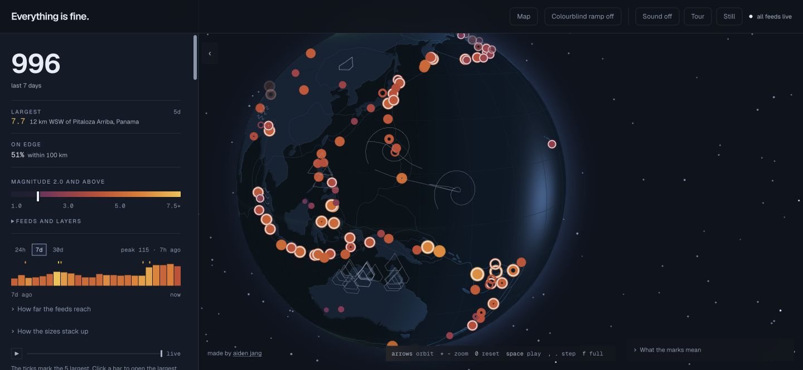
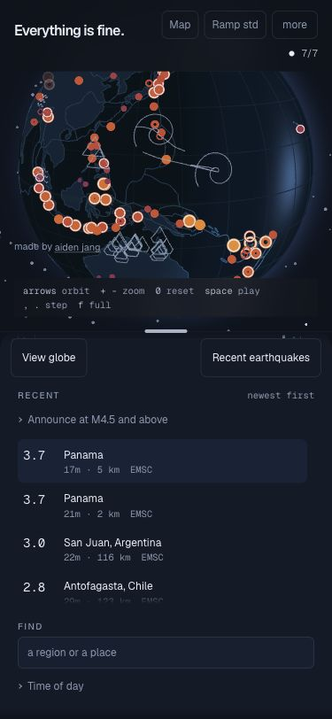
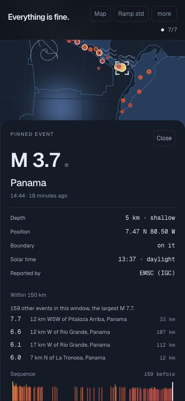
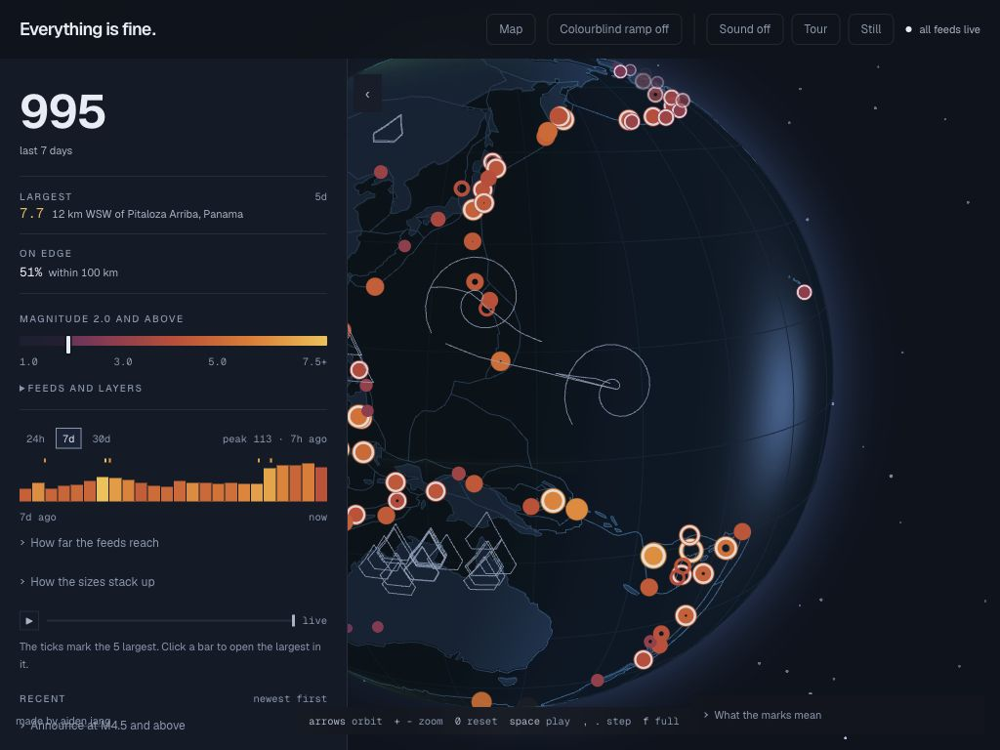

# UI review, October 14, 2026

Reviewed the exploration polish branch with live public feeds in Chrome. These captures show the
responsive interface at the desktop viewport, a 375px portrait phone layout, and a 1024px landscape
tablet layout. This is browser emulation, not a physical-device or screen-reader certification.
The data and counts in the captures belong to the review moment.

- Desktop: neutral controls, visible magnitude ramp, live-feed status, and globe framing.
- Phone: switching to recent events makes event rows immediately reachable; pinning an event leaves
  its marker above the detail sheet and provides a visible close control.
- Tablet: header controls fit the screen, with the globe and scrolling filter rail remaining usable.
- Startup and failure: loading has a visible status; graphics failures preserve the event interface
  and provide a retry action. Browser regression tests cover recovery and archive cancellation.

The review preserves the existing globe palette and shape language. It adds recovery and loading
states, fixes held-cursor sharing and returning to live, and moves archive/capture responsibilities
out of the main view. Fixture-backed browser tests settle overflow, keyboard interaction, reachability,
selection, shared links, and layout geometry independently of provider availability.

