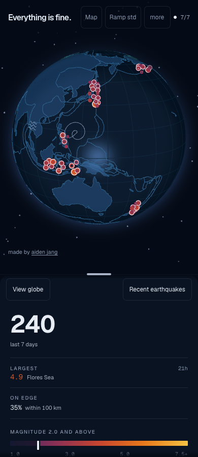
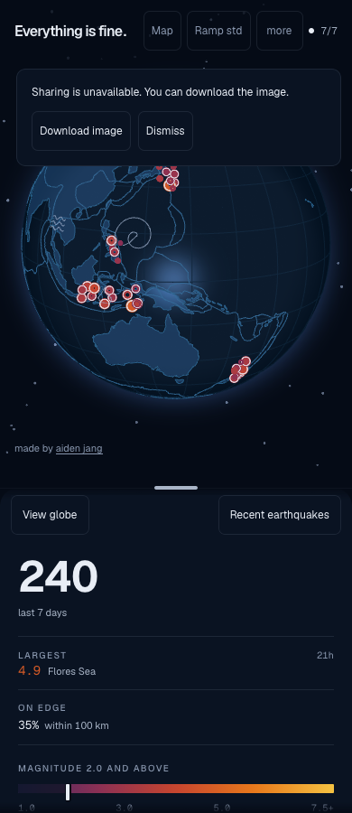
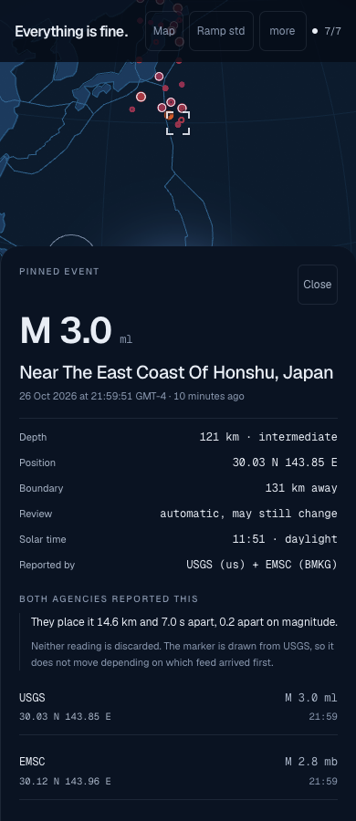
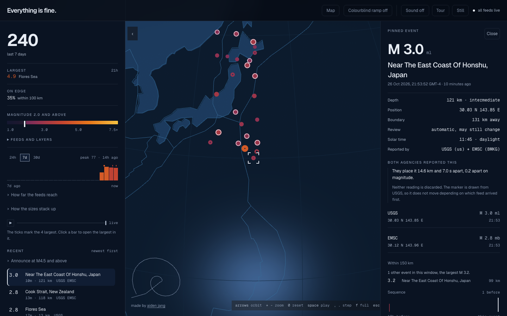

# October 26 recovery and responsive review

This pass reviews the changes based on `b8df968`, using Node 22.22.2, pnpm 9.15.0 and local
recorded feeds. Production journeys and development instrumentation use separate loopback origins.

## Changes reviewed

- Phone utilities move keyboard focus into the disclosure, dismiss outside or with Escape, and
  return focus after an action. Closing them does not change the pinned event or held time.
- A refused share sheet retains its captured PNG for an explicit download. Cancelling the sheet
  stays silent. A missing globe explains why no still can be made.
- Invalid saved palettes and non-finite dimensions fall back safely without rewriting storage on mount.
- Resize cancellation, window blur and cleanup release the drag styles.
- Source restart races ignore old answers. EMSC connection refusals retry, and failed sockets close.
- A persistent heading and main landmark keep the tool navigable with assistive technology.
  Filter and detail panels have distinct names. Largest-event and sequence actions retain their
  visible labels in their spoken names.

## Review conditions

The responsive journeys inspect live controls, phone utilities, share recovery and pinned-event
states at widths 320, 390, 768, 1024 and 1440, each 900px high with reduced motion. They assert
page bounds, usable rail space and notice placement, then save viewport captures for visual review.
These conditions describe this dated run; current test inventory comes from the test runner.
WebKit captures use touch input; the Chromium desktop capture uses an ordinary pointer.
The accessibility cases found no axe violations in the reviewed live and pinned views.
See [conditions](conditions.json) for the exact local capture setup.

The complete verification also covers normal motion, camera arrival, WebGL failure, archive races,
source contracts, heap/performance budgets, keyboard navigation and clipboard refusal.
Core checks, focused release regressions, accessibility cases and touch-enabled WebKit cases passed
locally. The full browser inventory runs on GitHub for the committed revision. Seed assertions read
the public reporting count; held-window comparisons wait for the opening replay to finish.

## Selected captures

| Phone live view | Phone sharing recovery |
| --- | --- |
|  |  |

## Limits

Fixtures do not establish current agency availability. Emulation does not establish native iOS/Android
sharing, a physical phone's touch behavior or spoken screen-reader output. The
[visitor walkthrough](../../visitor-review.md) records those follow-up observations separately.
